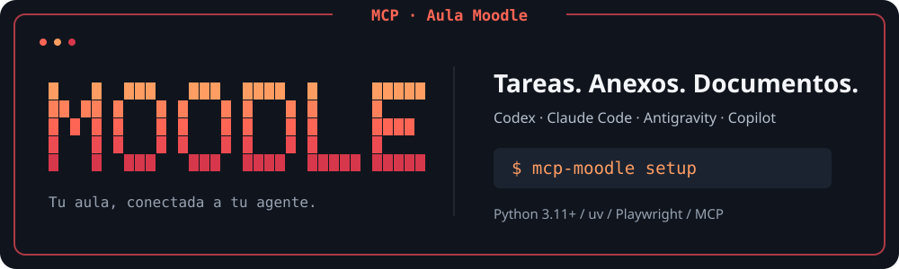
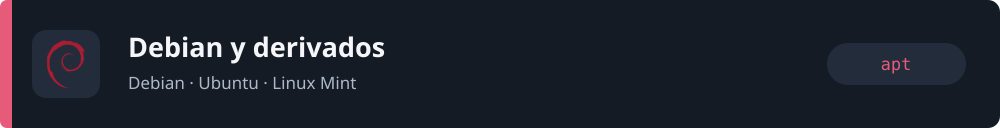
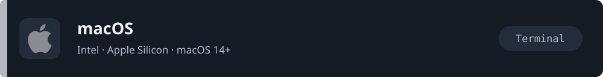

<p align="center">
  
</p>

<h1 align="center">Moodle MCP</h1>

<p align="center">
  Conecta tu cuenta de Moodle con tu agente y trabaja desde una sola conversación.
</p>

<p align="center">
  <a href="#instalacion">Instalación</a> ·
  <a href="#opciones-extras">Opciones extras</a> ·
  <a href="#entregables">Entregables</a> ·
  <a href="docs/MCP.md">Guía MCP</a> ·
  <a href="docs/DOCUMENT_OUTPUT.md">Documentos</a>
</p>

| Consulta tus tareas | Descarga los anexos | Prepara tus documentos |
| :--- | :--- | :--- |
| Próximas cinco pendientes, materia y tiempo restante. | Descarga autenticada con la misma sesión de Moodle. | DOCX y PDF con portada ULEAM, APA 7 y Times New Roman. |

Compatible con **Codex, Claude Code, Cursor, Google Antigravity y Copilot**. Usa Python, `uv` y Playwright. Las instrucciones y los anexos se consultan cuando eliges una tarea para trabajar en ella.

<p align="center">
  <a href="https://openai.com/codex" title="Codex"></a>
  &nbsp;&nbsp;
  <a href="https://www.anthropic.com/claude-code" title="Claude Code"></a>
  &nbsp;&nbsp;
  <a href="https://cursor.com/" title="Cursor"></a>
  &nbsp;&nbsp;
  <a href="https://antigravity.google/" title="Google Antigravity"></a>
  &nbsp;&nbsp;
  <a href="https://github.com/features/copilot" title="GitHub Copilot"></a>
</p>

<p align="center"><sub>Codex &nbsp;·&nbsp; Claude Code &nbsp;·&nbsp; Cursor &nbsp;·&nbsp; Google Antigravity &nbsp;·&nbsp; Copilot</sub></p>

---

## Requisitos

- Windows 11 o Windows Server 2019+, macOS 14+, o Linux con las bibliotecas necesarias para Chromium. El CI comprueba Windows Server 2025, Ubuntu 24.04, Arch Linux y macOS 15 en Intel y Apple Silicon.
- `uv`; obtiene Python 3.11 automáticamente si hace falta.
- Una cuenta activa en Moodle, acceso a Internet y un agente compatible instalado.

Los requisitos del navegador se basan en la [documentación oficial de Playwright](https://playwright.dev/python/docs/intro).

<a id="instalacion"></a>

## Elige tu sistema

La unica instalacion soportada consiste en clonar este repositorio con Git. Consulta [INSTALL.md](docs/INSTALL.md).

<table>
  <tr>
    <td align="center"><a href="#windows"><br><strong>Windows</strong></a><br>PowerShell</td>
    <td align="center"><a href="#debian"><br><strong>Debian y derivados</strong></a><br>apt</td>
    <td align="center"><a href="#arch"><br><strong>Arch y derivados</strong></a><br>pacman</td>
    <td align="center"><a href="#macos"><br><strong>macOS</strong></a><br>Intel / Apple Silicon</td>
  </tr>
</table>

Instala `uv` siguiendo el bloque de tu sistema y abre una terminal nueva. Los comandos de instalación de `uv` proceden de su [guía oficial](https://docs.astral.sh/uv/getting-started/installation/).

---

<a id="windows"></a>


### Windows — PowerShell

Clona el repositorio y entra en su carpeta:

```powershell
git clone https://github.com/ElkinDelgado25/Moodle_Homework_assignment.git
cd .\Moodle_Homework_assignment
```

Luego ejecuta el instalador incluido:

```powershell
powershell -ExecutionPolicy Bypass -File .\INSTALAR-WINDOWS.ps1
```

El instalador prepara `uv`, deja `mcp-moodle` en el PATH, descarga Chromium y abre el asistente para configurar Moodle y conectar un agente. Cierra las terminales que ya estaban abiertas y abre una nueva para usar el comando desde cualquier carpeta.

### Configurar otra cuenta o mas agentes

```powershell
mcp-moodle setup
```

El asistente permite cambiar las credenciales o conectar otro agente.

> **Importante:** el comando correcto es `mcp-moodle`, no `moodle-mcp`. `moodle-mcp` inicia el servidor MCP y no acepta la opción `setup`.

---


<a id="debian"></a>



### Debian y derivados

1. Clona el repositorio:

   ```bash
   git clone https://github.com/ElkinDelgado25/Moodle_Homework_assignment.git
   ```

2. Entra en la carpeta del repositorio:

   ```bash
   cd Moodle_Homework_assignment
   ```

3. Ejecuta el instalador:

   ```bash
   bash ./INSTALAR-DEBIAN.sh
   ```

El instalador muestra tres secciones con Rich y tiempos estimados. Deja `mcp-moodle` en el PATH, pregunta antes de instalar las bibliotecas de Chromium y solicita la contrasena de `sudo` una sola vez si aceptas. Abre una terminal nueva para usar el comando desde cualquier carpeta.

Para configurar otra cuenta o conectar mas agentes:

```bash
mcp-moodle setup
```

---

<a id="arch"></a>


### Arch Linux y derivados

1. Clona el repositorio:

   ```bash
   git clone https://github.com/ElkinDelgado25/Moodle_Homework_assignment.git
   ```

2. Entra en la carpeta del repositorio:

   ```bash
   cd Moodle_Homework_assignment
   ```

3. Ejecuta el instalador:

   ```bash
   bash ./INSTALAR-ARCH.sh
   ```

El instalador prepara `uv`, deja `mcp-moodle` en el PATH, instala el paquete `chromium` y abre el asistente de Moodle. Puede pedir la contrasena de `sudo`. Abre una terminal nueva para usar el comando desde cualquier carpeta.

Para configurar otra cuenta o conectar mas agentes:

```bash
mcp-moodle setup
```

---

<a id="macos"></a>



### macOS — Intel y Apple Silicon

1. Clona el repositorio:

   ```bash
   git clone https://github.com/ElkinDelgado25/Moodle_Homework_assignment.git
   ```

2. Entra en la carpeta del repositorio:

   ```bash
   cd Moodle_Homework_assignment
   ```

3. Ejecuta el instalador:

   ```bash
   bash ./INSTALAR-MACOS.sh
   ```

El instalador prepara `uv`, deja `mcp-moodle` en el PATH y abre el asistente. Usa una terminal nativa de tu Mac; `uv` y Playwright descargan Python y Chromium para su arquitectura. El asistente guarda la cuenta en `~/Library/Application Support/moodle-homework-assignment/`. Abre una terminal nueva para usar el comando desde cualquier carpeta.

Para configurar otra cuenta o conectar mas agentes:

```bash
mcp-moodle setup
```

`mcp-moodle run` muestra el panel de Aula Moodle. Si ya tienes una cuenta guardada, elige **4. Validar cuenta** para comprobar el acceso. También puedes usar `mcp-moodle status`. Sigue [los pasos completos de instalación](docs/INSTALL.md).

---

<a id="opciones-extras"></a>

## Opciones extras

Despues de instalar, abre una terminal nueva y usa estos comandos desde cualquier carpeta:

| Opcion | Comando |
| --- | --- |
| Ver el estado de la cuenta | `mcp-moodle status` |
| Buscar e instalar una release estable | `mcp-moodle update` |
| Abrir el asistente y conectar otra cuenta o agente | `mcp-moodle setup` |
| Consultar las proximas tareas pendientes | `mcp-moodle tasks` |
| Consultar tareas vencidas | `mcp-moodle tasks --mode overdue` |
| Revisar todas las materias | `mcp-moodle tasks --mode all --refresh` |
| Abrir de nuevo el panel de configuracion | `mcp-moodle run` |

Para integrar Moodle con Codex, Claude, Cursor, Antigravity o Copilot, usa el asistente con `setup`. Cursor tambien detecta la configuracion incluida en [.cursor/mcp.json](.cursor/mcp.json) al abrir este repositorio. Los comandos manuales y las herramientas MCP estan explicados en [MCP.md](docs/MCP.md).

> **Importante:** no sustituyas el orden del nombre. Para configurar usa `mcp-moodle setup`; `moodle-mcp` es el servidor y solo acepta opciones como `--env-file`. Actualiza con `mcp-moodle update`; las instrucciones están en [INSTALL.md](docs/INSTALL.md).

## Entregables

Al pedir resolver una tarea, el agente usa `get_assignment()`, que incluye la consigna, la plantilla y los pasos para preparar los entregables sin recordatorios adicionales. Debe leer los anexos y resolver los requisitos de esa actividad antes de presentar los archivos. La plantilla también se puede consultar con `get_document_template()`. La portada ULEAM y el logo estan incluidos en el repositorio en [academic-cover.docx](src/moodle_tasks/assets/academic-cover.docx) y [uleam-logo.png](src/moodle_tasks/assets/uleam-logo.png).

El resultado documental predeterminado contiene dos archivos con el mismo nombre:

- Un DOCX editable.
- Un PDF exportado desde ese DOCX.

La portada contiene los campos de materia, docente, estudiantes, carrera, curso y ano. El desarrollo comienza en la pagina siguiente y aplica APA 7 con Times New Roman de 12 puntos. Consulta la [politica completa de entregables](docs/DOCUMENT_OUTPUT.md) para los campos, formato y revision final.

## Notas

- Si Moodle responde con un error como `HTTP 502`, la consulta no se completó. Vuelve a intentarlo cuando el servidor esté disponible.
- La búsqueda rápida respeta el filtro de la línea de tiempo; la completa consulta los índices de las materias visibles en Mis cursos. Ambas muestran su alcance. Si no encuentra resultados, no puede descartar tareas fuera de esa cobertura.
- Para identificar pendientes comprueba los datos de entrega y nota disponibles en los listados: una actividad ya calificada o que indique no subir documentos no se cuenta como pendiente solo por figurar sin entrega.
- Las cuentas institucionales de ULEAM usan Microsoft 365 y la selección del mismo perfil cuando aparece «Use a different account». Si Microsoft exige CAPTCHA, códigos o verificación adicional, el programa no los resuelve ni afirma que la sesión esté validada.
- El programa no entrega tareas ni modifica información en Moodle.

---

<p align="center">
  <a href="docs/INSTALL.md">Instalación completa</a> ·
  <a href="docs/MCP.md">Conexión de agentes</a> ·
  <a href="docs/assets/readme/SOURCES.md">Créditos visuales</a>
</p>
